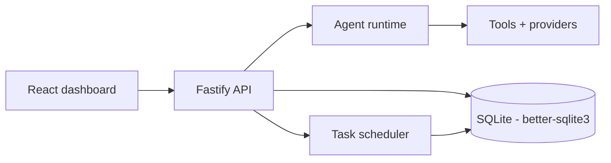

# Bankai OS

A local-first agent operating system for a personal AI stack: a Fastify API
that serves agents, runs and streams their work, and persists everything in
SQLite — with a React dashboard on top.

The API is the product surface; the packages underneath it (agents, tasks,
tools, database, config) are independently usable.

## Architecture



- **Agent runtime** — plans, streams and stores agent runs and their events.
- **Task scheduler** — queues background work, survives restarts (runs that
  were in flight are marked `interrupted` on boot, not lost).
- **SQLite storage** — WAL mode, migrations applied on start, repositories
  for agents, conversations, messages, runs, tasks, memory and settings.
- **Migrations** — versioned and applied automatically, no `db:push`.

## Quick start

```bash
npm install
npm run build:packages     # workspace packages publish dist/ entry points
npm run dev:server         # Fastify API on :8080
npm run dev:dashboard      # Vite dashboard on :5173
```

Environment (`.env`):

| Variable | Purpose |
|---|---|
| `BANKAI_TOKEN` | Bearer token required on `/api/*` (open when unset) |
| `DB_PATH` | SQLite file location |
| `HOST` / `PORT` | Bind address |
| `OPENCODE_API_KEY` | OpenCode (Zen) API key - the default provider. Note: OpenCode's `*-free` models only work inside the OpenCode client; API-key clients (like this project) can use the paid models |
| `GROQ_API_KEY` / `OPENAI_API_KEY` | Optional Groq / OpenAI keys |

## API

| Method | Route | Purpose |
|---|---|---|
| `GET` | `/health` | Liveness (no auth) |
| `GET` | `/ready` | Readiness - pings the database, 503 when it is down |
| `GET` | `/api/agents` | List agents |
| `POST` | `/api/agents` | Create an agent |
| `GET` | `/api/conversations` | List conversations |
| `GET` | `/api/settings` | Read settings |
| `PUT` | `/api/settings` | Write settings |

Authentication is a bearer token compared against `BANKAI_TOKEN`; the hook
runs **before** routing, so even unknown `/api/*` paths answer 401 rather
than leaking which routes exist.

## Packages

| Package | What it owns |
|---|---|
| `@bankai/contracts` | Zod schemas shared by every package |
| `@bankai/config` | Typed, validated environment configuration |
| `@bankai/db` | SQLite client, migrations and repositories |
| `@bankai/tools` | Tool definitions and execution |
| `@bankai/agent` | The agent runtime |
| `@bankai/tasks` | Scheduler and worker loop |

## Testing

```bash
npm test          # vitest: API route integration, SQLite repositories, contract schemas
npm run lint
npm run typecheck
```

The suites are offline and deterministic: the API tests drive the real
Fastify instance with `app.inject()`, and the repository tests run against a
real in-memory SQLite database.

## CI

`npm ci` → build workspace packages (in dependency order) → lint, typecheck
and test, plus a dashboard bundle build. Every push runs all of it.
